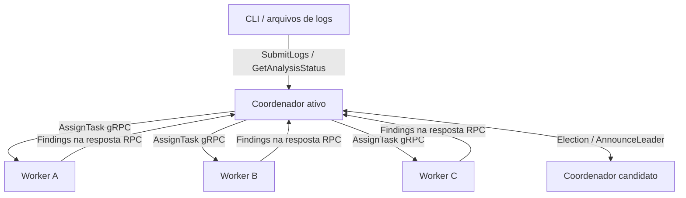
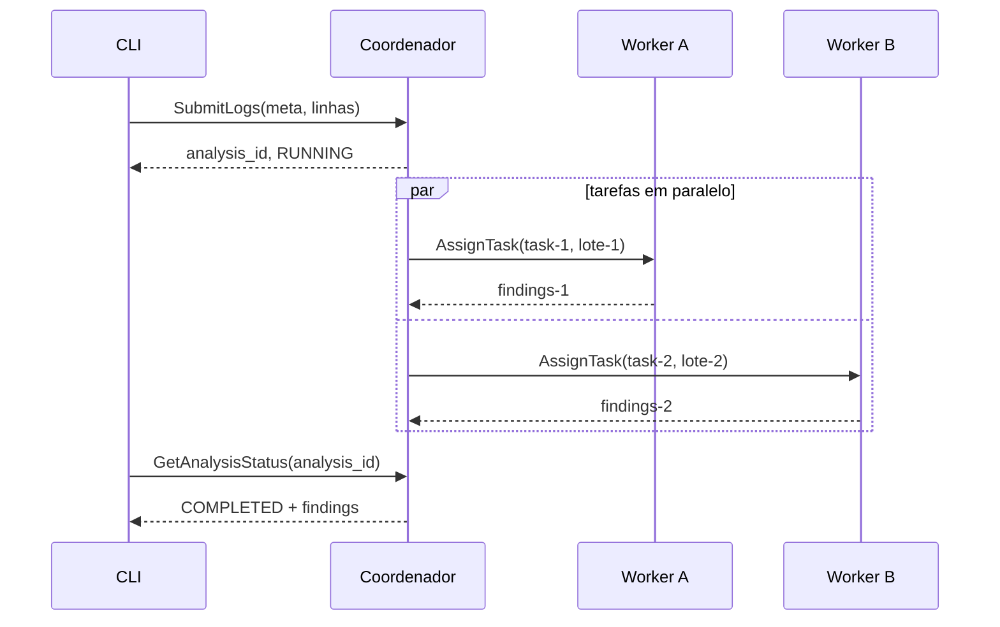

# Issue #2 — arquitetura e contratos (Entrega 1)

## Escopo e decisões
O DebugMesh recebe **arquivos de logs de CI/CD** como cenário de demonstração, mas não depende de GitHub Actions nem de uma aplicação específica. Os logs são sintéticos, divididos em lotes independentes; workers aplicam analisadores determinísticos e o coordenador reúne *findings* para consulta.

**Tecnologia escolhida para o contrato:** gRPC sobre HTTP/2 e Protocol Buffers v3. Vantagens: tipagem das mensagens, geração de clientes/servidores, transporte entre processos e prazos por chamada. O contrato versionado está em `proto/debugmesh/v1/debugmesh.proto`. Nenhuma API externa de IA é necessária.

## Topologia


- **Cliente:** envia conjunto de linhas e consulta por `analysis_id`.
- **Coordenador ativo:** particiona por tamanho configurável, gera `task_id`, faz chamadas concorrentes a workers e agrega resultados; o estado inicial pode residir em memória. Não existe consenso nem replicação nesta entrega.
- **Workers:** processos independentes com `WorkerService` exposto em endereços distintos; processam linhas e devolvem `Finding` com evidências rastreáveis.
- **Coordenador candidato:** processo elegível à liderança. Algoritmo Bully simplificado, prioridades numéricas únicas (maior ganha) e peers conhecidos via configuração. Uma eleição sem quórum ou uma partição de rede não garante líder único; o MVP pressupõe LAN confiável para eleição e registra essa limitação. Recuperação robusta fica para entrega 2.
- **Agregação:** inicialmente integrada ao coordenador, evitando novo serviço desnecessário.

## Dados e protocolos
- Cada chamada carrega `Envelope`: `request_id`, `sender_id`, `logical_timestamp`. Para Lamport: incrementar antes do envio; no recebimento `clock=max(local, recebido)+1`. Timestamp lógico expressa causalidade **entre eventos do DebugMesh**, não ordena eventos originais de aplicações externas.
- `SubmitLogs` recebe `source` e linhas numeradas e devolve `analysis_id`. `GetAnalysisStatus` devolve estado e resultados parciais/finais. O coordenador pode responder `ANALYSIS_RUNNING` enquanto trabalhos prosseguem.
- `AssignTask` é chamada síncrona coordenador → worker com `attempt` para futura deduplicação; a resposta contém findings. Não existe `SubmitFinding` assíncrono no MVP, para evitar dois fluxos concorrentes para o mesmo resultado.
- Os resultados reportam categoria, evidência, hipótese, correção sugerida, teste sugerido, confiança e timestamp. Analisadores determinísticos devem informar evidências observadas; não inferir correções com certeza artificial.
- `Election` e `AnnounceLeader` usam processos candidatos, **não workers sem papel de coordenador**. A prioridade do candidato deve ser única; `term` é apenas marcador de geração local, não fornece consenso.

## Endereços e execução proposta
```text
coordinator-a : localhost:50051   priority=20
coordinator-b : localhost:50052   priority=10
worker-a      : localhost:50061
worker-b      : localhost:50062
worker-c      : localhost:50063
```
Variáveis propostas: `DEBUGMESH_NODE_ID`, `DEBUGMESH_BIND_ADDRESS`, `DEBUGMESH_WORKER_ADDRESSES` (endereços separados por vírgula), `DEBUGMESH_COORDINATOR_PEERS` (id,priority,address), `DEBUGMESH_PRIORITY`, `DEBUGMESH_BATCH_SIZE`. Usar `0.0.0.0` apenas para bind de servidor em contêiner; clientes usam hostname/IP alcançável. O projeto ainda precisa implementar os processos e o comando de inicialização (issue #8/#3).

## Sequência de análise típica


## Falhas, prazos e códigos gRPC
- `INVALID_ARGUMENT`: entrada vazia, linhas inválidas ou identificação ausente.
- `NOT_FOUND`: `analysis_id` inexistente.
- `UNAVAILABLE`: worker/peer inacessível; o coordenador registra falha da tarefa.
- `DEADLINE_EXCEEDED`: chamada não concluída no prazo.
- `FAILED_PRECONDITION`: envio ao coordenador que sabe não ser líder.
- `INTERNAL`: falha não prevista, com mensagem sanitizada.

**Política inicial proposta:** timeout de 3 s por `AssignTask` e 2 s por `Election`/`AnnounceLeader`, parametrizáveis. Respeitar deadlines do gRPC. A entrega 1 deve registrar erros claramente; reatribuição automática/retries robustos são da entrega 2. Em falha parcial, não declarar `COMPLETED` sem política explícita; retornar `FAILED` com erro e findings disponíveis.

## Fronteiras com as outras issues
Esta issue **define** responsabilidades, contratos, topologia e sequência. Implementar servidor coordenador, workers, relógios Lamport, eleição, testes funcionais e instruções executáveis cabe às issues #8, #9, #10 e #3. O contrato é a referência comum para essas implementações.
